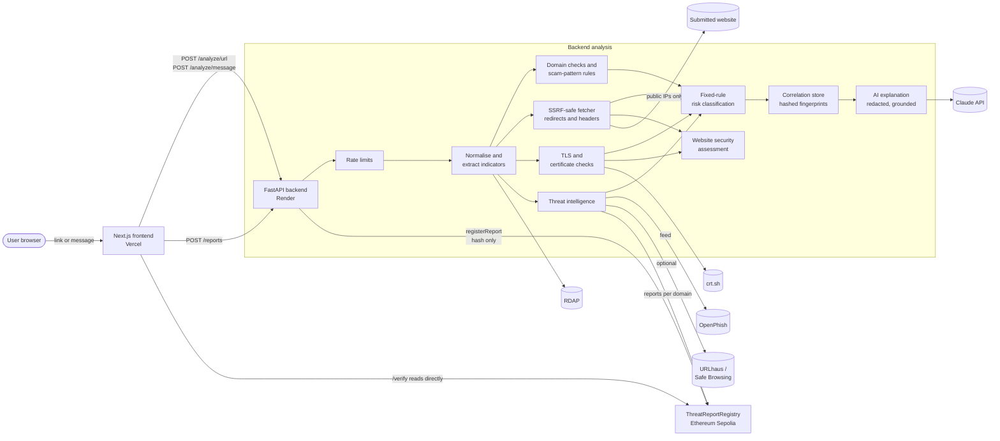

# Vexora

Vexora investigates suspicious links and messages, explains the evidence, and records tamper-evident threat reports on-chain.

## Problem

Phishing sites, fraudulent payment links and scam messages can closely imitate trusted organisations. Existing tools tend to check these risks separately and often give a verdict without showing the evidence behind it.

## Solution

Anyone can submit a URL, domain, email or message. Vexora runs security checks, explains the findings in plain language, and gives a risk classification with its evidence, sources and limitations. Users can then register a cryptographic commitment to a threat report on-chain, so anyone can check that it has not been altered.

A blockchain record proves a report's integrity and history, not that the report is true. A valid TLS certificate, or the absence of known threats, is never treated as proof that a site is safe.

| Problem statement module | What Vexora does |
|---|---|
| 1. URL and website analysis | Normalisation, impersonation and typosquatting, homographs, redirects, threat intelligence, domain age, risk classification |
| 2. TLS and web trust | Certificate verification against Mozilla's root store, names, expiry, key strength, signature algorithm, distrusted CAs, Certificate Transparency, a certificate verdict |
| 3. Scam and message analysis | Extraction of links and contacts, 11 scam-pattern rules, link checks, brand-mismatch detection, AI explanation grounded in quotes |
| 4. Threat correlation | Links reports by shared domains, destinations, servers, phone numbers, UPI IDs and wording |
| 5. Website security assessment | Passive checks of HSTS, CSP, clickjacking, cookies, version disclosure and legacy TLS, each with impact and a fix |
| 6. Decentralised threat intelligence | On-chain registry with revisions, disputes and validation, plus in-browser verification |

## Demo links and screenshot

- Live demo: https://vexora-app.vercel.app
- Verify a registered report: https://vexora-app.vercel.app/verify
- API: https://vexora-s6pt.onrender.com (interactive docs at `/docs`)
- Demo video (3 minutes maximum): TODO
- Pitch deck: TODO
- Threat registry contract (Ethereum Sepolia testnet): [`0x5c886E470a08D0C30D6b1871989B3b6A9c5bca9C`](https://sepolia.etherscan.io/address/0x5c886E470a08D0C30D6b1871989B3b6A9c5bca9C)
  - Deployment transaction: [`0x992b9d28...60c0eb`](https://sepolia.etherscan.io/tx/0x992b9d28fbf584420a04e25f170bf75a3c73deae6c666bd8c77f17c9a960c0eb) (block 12083376)
  - Example report registration: [`0x513c60ae...7d7f171`](https://sepolia.etherscan.io/tx/0x513c60aeed7ca1d202bda214c027dd2e22674b0367cf514c8a7cd299f7d7f171), commitment `0x5a278772e3e0e9be26a2da13131051020dd125e13f17d2ecda03e8402a999ddf`
  - Details: [contracts/deployments/sepolia.json](contracts/deployments/sepolia.json)

TODO: add a screenshot of a report, saved as `docs/screenshot.png`, and link it here.

## Tech stack

- Frontend: Next.js, TypeScript, ethers.js (Vercel)
- Backend: Python, FastAPI, HTTPX, cryptography, tldextract, web3.py (Render)
- Blockchain: Solidity, Hardhat, Ethereum Sepolia testnet
- AI: Claude (`claude-haiku-5-5`) through the Anthropic Python SDK, for explanations only
- Threat intelligence: OpenPhish community feed, with optional URLhaus and Google Safe Browsing, plus Vexora's own on-chain registry
- Domain intelligence: RDAP (rdap.org) and Certificate Transparency logs (crt.sh)
- Storage: no database. Caches and the correlation store are in memory and expire; the Sepolia contract is the permanent record.

## Architecture



### How a link check flows

1. **Rate limit and cache:** the visitor's budget is checked, and a result from the last 30 minutes for the same normalised link is reused if there is one.
2. **Normalise:** the link is cleaned up (defanged links restored, punycode, registered domain found).
3. **Checks in parallel:** domain checks (no network), threat intelligence (OpenPhish, optional URLhaus and Safe Browsing, and the on-chain registry), domain age, and Certificate Transparency. If threat intelligence already confirms the link, the site is never contacted.
4. **Fetch safely:** redirects are followed one hop at a time, connecting only to public IPs on ports 80 and 443, to the exact IP that was checked. Page content is never read or run.
5. **TLS and website security:** the certificate is verified and described, and response headers are assessed. Security findings are kept separate from the risk level.
6. **Classify:** fixed rules turn the indicators into Low Risk, Suspicious, High Risk, Confirmed Malicious or Inconclusive.
7. **Correlate:** the report is linked to earlier suspicious reports by exact matches.
8. **Explain:** Claude writes a plain-language summary from the findings. It cannot change the risk level, and messages are redacted before sending.
9. **Register (optional):** for suspicious reports, the user can register a salted hash on Sepolia and download the report file. The `/verify` page recomputes the hash in the browser and reads the contract directly.

### Repository layout

| Path | Contents |
|---|---|
| `backend/app/url_analysis/` | Normalisation, safe fetching, domain checks, TLS, threat intelligence, website security, classification |
| `backend/app/message_analysis/` | Extraction, redaction, scam rules, message analyser |
| `backend/app/correlation.py` | Threat correlation store |
| `backend/app/ai.py` | Claude explanation layer |
| `backend/app/registry/` | Report packages, commitments and blockchain transactions |
| `backend/app/cache.py`, `rate_limit.py`, `report_cache.py` | Caching and rate limits |
| `frontend/src/app/` | Report page, registry panel and `/verify` page |
| `contracts/` | Solidity contract, tests, deploy and management scripts |
| `docs/` | Detailed design and test documentation |

### Documentation

- [docs/url-analysis.md](docs/url-analysis.md): link analysis, TLS, website security, caching and safety
- [docs/message-analysis.md](docs/message-analysis.md): message rules and the AI layer
- [docs/correlation.md](docs/correlation.md): threat correlation
- [docs/web3-registry.md](docs/web3-registry.md): the on-chain registry and verification
- [docs/testing-report.md](docs/testing-report.md): every automated test suite and live test case

## Setup and run steps

Copy each `.env.example` file to `.env` (`.env.local` for the frontend) and fill in your own values. Never commit real keys. Every external service is optional: without keys, Vexora still runs, and each report lists what was not checked.

### Backend

```bash
cd backend
python -m venv .venv
source .venv/Scripts/activate
pip install -r requirements.txt
uvicorn app.main:app --reload
pytest
```

The API runs at http://localhost:8000, with interactive docs at `/docs`.

### Frontend

```bash
cd frontend
npm install
npm run dev
```

The app runs at http://localhost:3000.

### Contracts

```bash
cd contracts
npm install
npm test
```

To run the registry on a local blockchain or deploy it to Sepolia, see [docs/web3-registry.md](docs/web3-registry.md).

## Disclosures

- Libraries: FastAPI, Pydantic, Uvicorn, HTTPX, idna, tldextract, cryptography, certifi, Anthropic Python SDK, web3.py, pytest, Next.js, React, ethers.js, Hardhat, Hardhat Toolbox
- Data sources: OpenPhish community feed, URLhaus, Google Safe Browsing, RDAP (rdap.org), crt.sh
- Templates: `create-next-app` for the frontend
- AI tools: Claude Code was used to generate the project skeleton and the URL analysis, message analysis, website security, correlation, caching, rate limiting and threat registry modules, and this documentation
- TODO: add every other library, API, template and AI tool you use

## Track

AI-Powered Web Threat Detection & Digital Trust Intelligence
